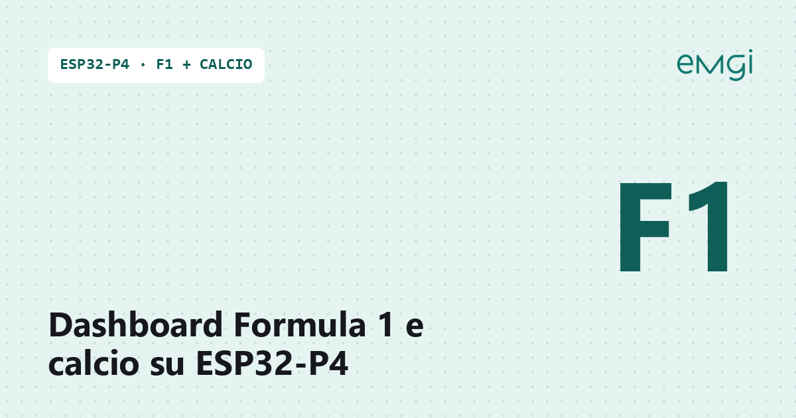
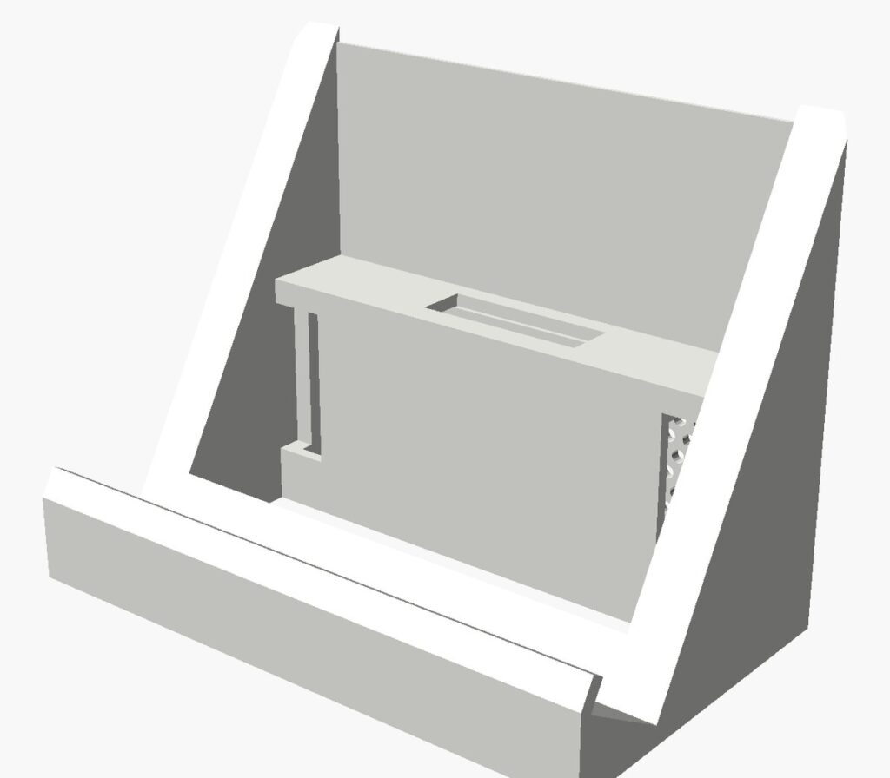

# Dashboard Formula 1 e calcio in tempo reale su ESP32-P4 7″

> 📖 **Articolo completo con foto, spiegazioni e problemi risolti:**
> **[www.emgi.it – Dashboard Formula 1 e calcio in tempo reale su ESP32-P4 7″ con case stampato in 3D](https://www.emgi.it/2026/10/04/dashboard-formula-1-calcio-tempo-reale-esp32-p4-case-3d/)**
>
> Altri progetti di elettronica, Arduino, ESP32 e stampa 3D su **[www.emgi.it](https://www.emgi.it)**

Display da scrivania che mostra **Formula 1 e calcio in tempo reale**, senza app, account o chiavi API, con **avvisi sonori** per gol, cambi di leader, Safety Car e bandiere. Firmware Arduino con LVGL 9, case stampato in 3D con supporto da tavolo e vano per lo speaker.

## Funzionalità

**Formula 1**
- Live timing di prove, qualifiche e gara: posizioni, distacchi, intervalli, pit stop, ritiri, giro, bandiere, SC/VSC, messaggi della direzione gara
- Frecce di sorpasso (posizioni guadagnate/perse)
- Classifica piloti, costruttori e risultato dell'ultima gara
- Mappa del circuito (sagoma ufficiale MultiViewer) con la **posizione stimata** delle monoposto; tocca un pilota nell'elenco per mostrarlo o nasconderlo (pulsanti TUTTI / NESSUNO, scelta salvata)
- Gomme di ogni pilota con colori ufficiali e giri percorsi

**Calcio**
- Serie A (con classifica), Nations League, Champions League, Europa League, Europei, Mondiali
- Partite da 2 giorni prima a 7 giorni dopo, aggiornamento ogni 60 s (20 s con partite in corso)
- Dettaglio partita: cronaca, statistiche, formazioni; indicatore espulsioni

**Avvisi sonori** sintetizzati dal firmware (nessun file audio): gol, fischi, cartellini rossi, partenza F1, nuovo leader, Safety Car/VSC/bandiera rossa, bandiera a scacchi.

**Altro:** standby dopo 2 minuti con risveglio al tocco o all'avviso, pagina web di configurazione (salvata in NVS), API HTTP per Home Assistant.

## Hardware

| Componente | Note |
|---|---|
| Waveshare **ESP32-P4-WIFI6-Touch-LCD-7B** | 7″ 1024×600 MIPI-DSI, touch GT911, ESP32-P4 + ESP32-C6 (WiFi 6), codec ES8311 |
| Altoparlante | quello in dotazione con la scheda |
| Alimentatore 5 V USB-C | |
| Viti piccole | per chiudere cornice e corpo |

## Fonti dati (tutte pubbliche, senza registrazione)

| Dato | Fonte |
|---|---|
| Partite, risultati, classifica Serie A, dettaglio partita | ESPN (`site.api.espn.com`) |
| Classifiche F1, ultima gara, calendario | Jolpica (`api.jolpi.ca`) |
| Live timing F1, gomme, passaggi sul traguardo | `livetiming.formula1.com` (SignalR su WebSocket) |
| Sagoma dei circuiti | MultiViewer (`api.multiviewer.app`), scaricata una volta e salvata in NVS |

> Le coordinate GPS delle monoposto (`Position.z`) il live timing le invia solo agli abbonati F1 TV: la posizione sulla mappa è quindi stimata dall'ultimo passaggio sul traguardo e dall'ultimo tempo sul giro di ogni pilota.

## Arduino IDE

- **Core esp32 Espressif 3.3.x** (testato con 3.3.12). ⚠️ Non usare il core 4.0 (alpha): `ESP32_Display_Panel` 1.0.4 non compila con ESP-IDF 6.
- **Librerie:** ESP32_Display_Panel, ESP32_IO_Expander, esp-lib-utils, lvgl 9.x, ArduinoJson 7.x

| Impostazione | Valore |
|---|---|
| Scheda | ESP32P4 Dev Module |
| Chip Variant | Before v3.00 |
| PSRAM | Enabled |
| Flash Size | 16MB (128Mb) |
| Partition Scheme | 16M Flash (3MB APP/9.9MB FATFS) |
| USB Mode | Hardware CDC and JTAG |

La prima compilazione richiede circa 15 minuti.

## Installazione

1. Clona o scarica il repository e apri `sport_p4/sport_p4.ino`.
2. In **`sport_p4/AppConfig.h`** inserisci SSID e password della tua rete WiFi (`LA_TUA_RETE` / `LA_TUA_PASSWORD`). È l'unico file da modificare.
3. Compila e carica via USB-C.
4. Apri `http://sport-p4.local` (oppure l'IP mostrato sul monitor seriale) per la configurazione.

**API HTTP:** `GET /api/stato` · `POST /api/imposta` (es. `luce=40`) · `POST /api/prova?s=gol`

**Comandi seriale (115200 baud):** `d` prova suoni · `m` avvisi on/off · `g` simula gol · `f` simula avviso F1

## Collegamenti elettrici

La scheda **Waveshare ESP32-P4-WIFI6-Touch-LCD-7B** integra già display, touch, WiFi (ESP32-C6) e codec audio: non ci sono fili da saldare.

| Collegamento | Dove |
|---|---|
| Altoparlante (in dotazione) | connettore **SPK / speaker** della scheda (uscita del codec ES8311) |
| Alimentazione e programmazione | porta **USB-C** della scheda, alimentatore **5 V** (almeno 2 A) |

- Collega lo speaker **prima** di chiudere il case: il cavetto passa dal corpo al vano del supporto.
- Per caricare lo sketch usa un cavo USB-C dati (non solo ricarica).

## Case stampato in 3D

File STL nella cartella [`case_3d`](case_3d):

| Pezzo | Dimensioni | File |
|---|---|---|
| Cornice | 174 × 109 × 5,4 mm | `case_esp32_p4_cornice.stl` |
| Corpo | 174 × 109 × 17,5 mm | `case_esp32_p4_corpo.stl` |
| Supporto (leggio con vano speaker) | 120 × 73 × 93 mm | `case_esp32_p4_supporto.stl` |
| Tappo vano speaker | 112 × 15,5 × 3 mm | `case_esp32_p4_tappo.stl` |

**Stampa:** PLA, 205 °C / piatto 60 °C, layer 0,2 mm, 3 perimetri, riempimento 20%. Cornice e corpo con la faccia piana sul piatto; supporto sulla base (verifica nello slicer se il ripiano del vano speaker richiede supporti).

**Montaggio:** carica lo sketch, collega lo speaker, chiudi la scheda tra cornice e corpo con le viti, inserisci lo speaker nel supporto e chiudi con il tappo.

## Licenza

- Codice: [MIT](LICENSE)
- Modelli 3D e immagini: [CC BY-SA 4.0](https://creativecommons.org/licenses/by-sa/4.0/deed.it)

---

**Autore:** Massimiliano Sandrin – **[eMGi.it](https://www.emgi.it)** · Domande e commenti sotto l'[articolo sul sito](https://www.emgi.it/2026/10/04/dashboard-formula-1-calcio-tempo-reale-esp32-p4-case-3d/).
